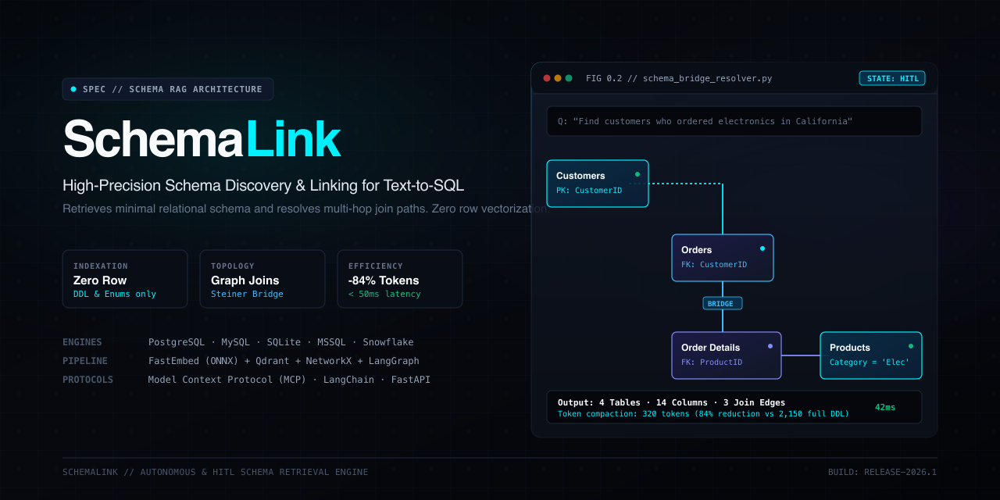

<div align="center">
  

  # SchemaLink
  ### High-Precision Schema RAG & Discovery Engine for Text-to-SQL

  [](https://github.com/Mu99Ti/SchemaLink)
  [](https://pypi.org/project/schemalink/)
  [](https://opensource.org/licenses/MIT)
  [](https://github.com/astral-sh/ruff)
  [](https://github.com/Mu99Ti/SchemaLink)
</div>

> **SchemaLink** is an independent, high-precision Schema RAG engine that solves context window overflow, hallucinations, and join fragmentation in enterprise Text-to-SQL systems -- without vectorizing a single database row.

---

## The Core Problem

When building Text-to-SQL or database Q&A over real enterprise databases (hundreds of tables, thousands of columns):

```
[x] Naive Approach 1: Pass Entire Schema DDL to the LLM
    - Context window explodes.
    - Token costs soar.
    - The model hallucinates similar-sounding columns across unrelated tables.

[x] Naive Approach 2: Vectorize All Database Rows
    - Huge security, privacy, and compliance nightmare.
    - Millions of rows to embed, maintain, and sync.
    - Fails completely on exact analytical aggregations (SUM, AVG, GROUP BY).
```

### The SchemaLink Solution

**The database remains the source of truth for business data.**  
**The vector store holds only schema metadata, domain rules, and categorical profiles.**

```
[ User Question ]
       |
       v
+--------------------------------------------------------+
| SchemaLink Engine                                      |
|   1. Multi-DB Router                                   |
|   2. Bidirectional Retrieval (Table-First + Col-First) |
|   3. Graph Join Resolver (In-Memory NetworkX)          |
|   4. Human-in-the-Loop Review (Optional)               |
|   5. Token Budgeting & Compact DDL Compactor           |
+--------------------------+-----------------------------+
                           |  Minimal Curated Schema (~30 lines DDL)
                           v
+--------------------------------------------------------+
| Downstream Query Generator Agent (LangChain / Llama)   |
|   - Writes exact, hallucination-free SQL               |
|   - Executes on operational database                   |
|   - Returns answer / tabular data                      |
+--------------------------------------------------------+
```

---

## Key Features

- **Zero Row Vectorization:** Never touches or vectorizes business records. Strictly indexes table descriptions, column definitions, and business terminology.
- **Hierarchical Multi-Database Routing:** Automatically matches question intent against database domain summaries to route to the correct target database, eliminating cross-database namespace collisions.
- **Bidirectional Hybrid Retrieval:**
  - **Table-First:** Discovers tables by description and synonyms.
  - **Column-First:** Searches metrics, dimensions, and enum values across all columns and promotes parent tables.
  - **Reciprocal Rank Fusion (RRF):** Fuses rankings deterministically.
- **Deterministic Graph Join Resolver:** Uses an in-memory NetworkX directed multigraph over physical foreign keys and user-injected virtual joins. Automatically discovers intermediate bridge tables (e.g., connecting `Customers` to `Products` via `Orders` and `Order Details`).
- **Categorical Value & Enum Profiling:** Automatically identifies low-cardinality enum columns (<= 50 distinct values). Resolves conversational values (e.g., `"California"`) to database literals (e.g., `'CA'`).
- **Additive Schema HyDE:** Extracts relational markers (antijoins, grouping grain, temporal operators) while preserving full query syntax for transformer attention heads.
- **Dual-Mode Execution (Autonomous & HITL):**
  - **Autonomous:** Sub-100ms automated confidence filtering.
  - **Human-in-the-Loop (HITL):** Pauses execution, returns candidate tables/columns to the user/UI for inspection, and resumes on approval.
- **Continuous Exemplar Learning:** Human feedback is indexed into an Exemplar Store to reinforce future retrieval for similar questions without model fine-tuning.
- **Token-Budgeted Context Compaction:** Compresses schema output by 40-75% using intelligent column pruning and Compact DDL generation.

---

## Architecture

```
+------------------------------------------------------------------------+
|                          SchemaLink Engine                             |
|                                                                        |
|   +-------------------------+            +-------------------------+   |
|   |   Database Connectors   |            | Business Logic Registry |   |
|   |  (SQLAlchemy Inspector) |            | (Custom Rules / Joins)  |   |
|   +------------+------------+            +------------+------------+   |
|                |                                      |                |
|                +------------------+-------------------+                |
|                                   v                                    |
|                    +----------------------------+                      |
|                    | Multi-Document Generator   |                      |
|                    | (DB, Table, Column, Enum)  |                      |
|                    +--------------+-------------+                      |
|                                   v                                    |
|       +-------------------------------------------------------+        |
|       | Storage & Indexing                                    |        |
|       |  - DB / Table / Column Collections (Qdrant)           |        |
|       |  - Exemplar Memory Store                              |        |
|       |  - In-Memory Relationship Graph (NetworkX)            |        |
|       +---------------------------+---------------------------+        |
|                                   v                                    |
|   User Question -------> +-------------------------+                   |
|                          | Query Router & Planner  |                   |
|                          +------------+------------+                   |
|                                       v                                │
|                          +-------------------------+                   │
|                          | Bidirectional Retrieval |                   │
|                          | (Table-first + Col-1st) |                   │
|                          +------------+------------+                   │
|                                       v                                │
|                          +-------------------------+                   │
|                          | Graph Join Resolver     │                   │
|                          | (Bridge Table Discovery)|                   │
|                          +------------+------------+                   │
|                                       v                                │
|                          +-------------------------+                   │
|                          | Mode Selection Switch   |                   │
|                          +-----+-------------+-----+                   │
|                                |             |                         │
|             Autonomous Mode    |             |  HITL Mode              │
|             (Direct Context)   |             v                         │
|                                |      +--------------+                 │
|                                |      | LangGraph    |                 │
|                                |      | Interrupt    |                 │
|                                |      +------+-------+                 │
|                                |             | User Feedback           │
|                                |             v                         │
|                                |      +--------------+                 │
|                                |      | Exemplar &   |                 │
|                                |      | Graph Boost  |                 │
|                                |      +------+-------+                 │
|                                +------+------+                         │
|                                       v                                │
|                     [ Curated Schema Context Package ]                 │
+---------------------------------------+--------------------------------+
                                        |
                                        v
                     +------------------------------------+
                     | Downstream Query Generator Agent   |
                     | (Generates SQL & Queries DB)       |
                     +------------------------------------+
```

---

## Installation

```bash
# Clone the repository
git clone https://github.com/anomalyco/schemalink.git
cd schemalink

# Create virtual environment
python3 -m venv .venv
source .venv/bin/activate

# Install with core dependencies
pip install -e .

# Optional: Install with developer tools
pip install -e ".[dev]"

# Optional: Install with MCP (Model Context Protocol) support
pip install -e ".[mcp]"
```

---

## Quickstart

### 1. Python SDK (In-Process)

```python
from schemalink import SchemaLink

# Initialize the engine
engine = SchemaLink()

# Register your operational database (PostgreSQL, MySQL, SQLite, Snowflake, etc.)
engine.register_database("sales_db", "sqlite:///northwind.db")

# Introspect schema, profile enums, and build hybrid indexes
engine.index_database("sales_db", profile_enums=True)

# Retrieve minimal schema context for a query
context = engine.retrieve_sync(
    query="Show total sales revenue by product category in 1997",
    database_id="sales_db",
    mode="autonomous"
)

# Output compact DDL ready for your SQL generation agent
print(context.to_prompt(format_type="compact_ddl"))
```

#### Output Example:
```sql
-- Database: sales_db (sqlite)
-- User Query: "Show total sales revenue by product category in 1997"

CREATE TABLE Products by Category ( -- Table containing Products by Category records
  CategoryName TEXT,
  ProductName TEXT,
  UnitsInStock INTEGER
  -- 2 other columns omitted
);

CREATE TABLE Product Sales for 1997 ( -- Table containing Product Sales for 1997 records
  CategoryName TEXT,
  ProductName TEXT,
  ProductSales REAL
);

-- Join Paths:
-- Products by Category.CategoryName = Product Sales for 1997.CategoryName
```

---

### 2. Injecting Domain Knowledge & Virtual Joins

If your physical database lacks foreign keys or uses cryptic column names:

```python
from src.registry.business_logic import TableAnnotation, ColumnAnnotation, VirtualForeignKey

# Add table synonyms and mandatory business rules
engine.registry.add_table_annotation(
    "sales_db",
    TableAnnotation(
        table_name="tbl_ord_hdr",
        business_synonyms=["orders", "sales transactions", "purchases"],
        business_rules=["Always filter status = 'COMPLETED' for revenue metrics"]
    )
)

# Add metric formulas
engine.registry.add_column_annotation(
    "sales_db",
    ColumnAnnotation(
        table_name="tbl_ord_hdr",
        column_name="tot_amt",
        business_synonyms=["revenue", "gross sales"],
        calculation_formula="SUM(tbl_ord_hdr.tot_amt - tbl_ord_hdr.discount)"
    )
)

# Declare virtual foreign keys (logical joins without database constraints)
engine.registry.add_virtual_foreign_key(
    "sales_db",
    VirtualForeignKey(
        source_table="tbl_ord_hdr",
        source_column="cust_code",
        target_table="tbl_customers",
        target_column="code"
    )
)
```

---

### 3. Human-in-the-Loop (HITL) Mode

```python
# 1. Initiate HITL session -- pauses and returns candidate elements
state = engine.initiate_hitl(
    query="List suppliers and products shipped by Speedy Express",
    database_id="sales_db"
)

# 2. Inspect candidate tables and confidence scores
print("Candidate tables:", [t[0].table_name for t in state.candidate_tables])

# 3. User reviews, adjusts, and approves
context = engine.submit_hitl_feedback(
    state=state,
    approved_tables=["Products", "Suppliers"],
    approved_joins=[{"source": "Products.SupplierID", "target": "Suppliers.SupplierID"}]
)

# Approved feedback is automatically stored in Exemplar Memory to boost future queries!
```

---

## Downstream Agent & LLM Integrations

### Model Context Protocol (MCP) Server
Run SchemaLink as a native MCP server for Cursor, Claude Desktop, Antigravity, and MCP clients:

```json
{
  "mcpServers": {
    "schemalink": {
      "command": "python",
      "args": ["-m", "src.integrations.mcp_server"]
    }
  }
}
```

The model can then call the `retrieve_schema` tool before writing SQL:
```text
retrieve_schema(query="Which branches generated the most revenue in Q3?")
```

### LangChain / LangGraph Tool
```python
from src.integrations.tools import create_langchain_tool

schema_tool = create_langchain_tool(engine)
agent = create_react_agent(llm, tools=[schema_tool])
```

### OpenAI / Anthropic Function Calling
```python
from src.integrations.tools import get_openai_tool_definition

tools = [get_openai_tool_definition()]
# Pass directly to client.chat.completions.create(..., tools=tools)
```

---

## REST API

Start the FastAPI server:

```bash
uvicorn src.api.server:create_app --factory --host 0.0.0.0 --port 8000
```

### Key Endpoints

| Method | Endpoint | Description |
| :--- | :--- | :--- |
| `POST` | `/api/v1/databases` | Register a database connection URI |
| `POST` | `/api/v1/databases/{id}/index` | Run schema introspection, enum profiling, and indexing |
| `POST` | `/api/v1/databases/{id}/annotations` | Inject business synonyms, rules, and virtual joins |
| `POST` | `/api/v1/retrieval/schema` | Run schema retrieval (`autonomous` or `hitl`) |
| `POST` | `/api/v1/retrieval/feedback` | Submit human feedback to resume paused HITL session |
| `GET` | `/health` | Service health check |

---

## Testing & Validation

SchemaLink includes a test suite covering unit, integration, and real-database benchmarks (tested against the 600,000+ row Northwind database):

```bash
# Run all tests
pytest tests/ -v -W ignore

# Run with coverage report
pytest --cov=src tests/
```

### Test Coverage Highlights
- Database Introspection & Dialects: Multi-table PK/FK extraction across SQLite and PostgreSQL.
- Categorical Value Profiler: Low-cardinality enum discovery and sample caching.
- Business Logic Registry: Persistent JSON-backed annotations and virtual foreign keys.
- NetworkX Join Resolver: Multi-hop bridge table discovery (`Customers` -> `Orders` -> `Order Details` -> `Products`).
- Query Parser & Additive HyDE: Relational marker detection, antijoins, and grouping grain parsing.
- Exemplar Memory Store: Continuous reinforcement learning from HITL feedback.
- FastAPI & REST: End-to-end HTTP lifecycle tests.

---

## Technology Stack

| Layer | Component | Description |
| :--- | :--- | :--- |
| **Catalog Introspection** | [SQLAlchemy 2.0](https://www.sqlalchemy.org/) | Multi-dialect catalog inspection (PostgreSQL, MySQL, SQLite, MSSQL, Snowflake) |
| **Vector & Hybrid Store** | [Qdrant](https://qdrant.tech/) | Dense vectors + BM25 sparse vectors with payload filtering |
| **Embeddings** | [FastEmbed](https://github.com/qdrant/fastembed) | Local 63MB quantized ONNX model (`BAAI/bge-small-en-v1.5`) without PyTorch |
| **Relationship Graph** | [NetworkX](https://networkx.org/) | In-memory directed multigraph for shortest join paths & Steiner bridge resolution |
| **Reranking** | [FlashRank](https://github.com/PrithivirajDamodaran/FlashRank) | Ultra-fast cross-encoder reranker for candidate refinement |
| **Workflow & HITL** | [LangGraph](https://github.com/langchain-ai/langgraph) | Stateful state machine with native `interrupt` / `resume` |
| **API Framework** | [FastAPI](https://fastapi.tiangolo.com/) + Pydantic v2 | High-throughput asynchronous REST API |

---

## License

This project is licensed under the MIT License - see the [LICENSE](LICENSE) file for details.
